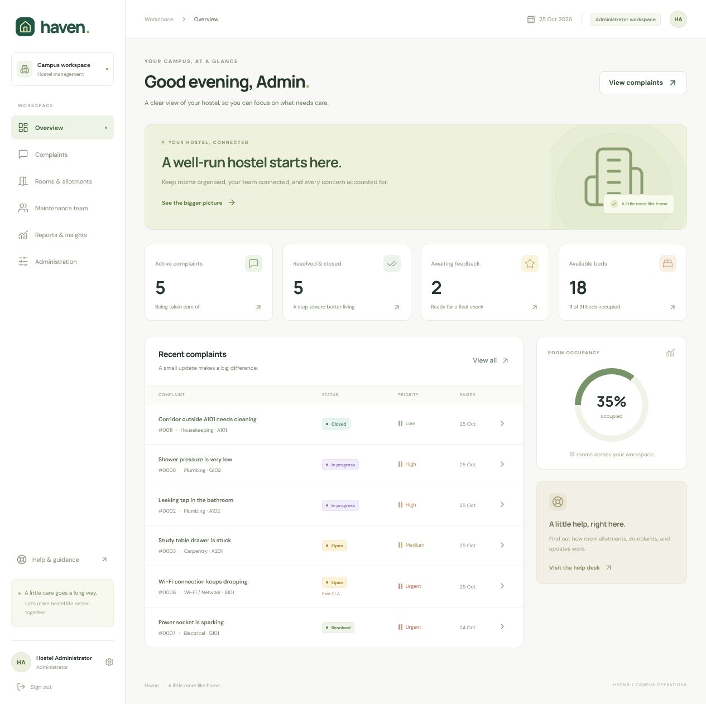

# Validation record

Validated locally on 25 October 2026 with Node.js 24.14.0 and MySQL Community
Server 8.4.9.

## Automated checks

- `npm run check`: backend syntax checks and frontend production build passed.
- `npm test`: 31 tests passed against a newly created real MySQL database.
- Confirmed exactly 13 base tables, 4 views, 6 triggers and 5 stored procedures.
- Concurrency tests verified one allocation for the last bed and one complaint
  for simultaneous submissions with the same room/category.
- Role/record ownership tests, admin editing safeguards, feedback closure,
  reopening, history authorship, account deactivation, password checks and UTC
  sessions passed.
- Test database removed after the run; development data was preserved.

## Browser checks

- Student, warden, staff and administrator sign-in.
- Student dashboard and room details with actual roommates and allotment history.
- Mobile room layout at 390 × 844; desktop layout at the browser's normal size.
- Created a complaint in the student UI; assigned it as the warden; started and
  resolved it as the matching staff member; submitted five-star feedback as the
  student. Verified CLOSED status and all five history entries after a reload.
- Confirmed timestamps display in local time after the UTC session correction.
- Inspected admin user forms and room availability/occupancy screens.
- No browser console errors were captured in the final dashboard check.

The extra browser-QA complaint remains in the local demonstration database as a
completed example. The repeatable seed script still creates the original ten
complaints.

